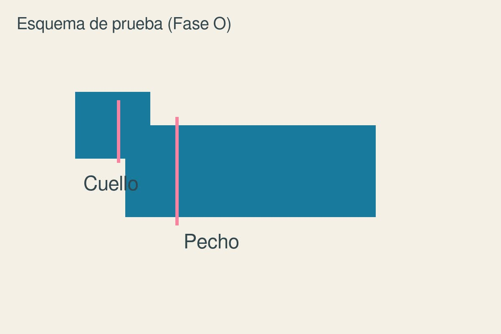

---
# Guía de tallas de un modelo (Fase O). El producto la elige con `guia_tallas = marca-m-arnes-a`.
# DATOS DE PRUEBA (producto prueba-arnes-estampado).
titulo: Tallas del arnés Modelo A
marca: Marca M
---

| Talla | Pecho (cm) | Cuello (cm) | Peso orientativo |
| ----- | ---------- | ----------- | ---------------- |
| XS    | 30–38      | 20–26       | hasta 3 kg       |
| S     | 38–48      | 26–34       | 3–7 kg           |
| M     | 48–60      | 34–42       | 7–15 kg          |
| L     | 60–76      | 42–52       | 15–28 kg         |
| XL    | 76–94      | 52–62       | más de 28 kg     |

**Este modelo**: mide también el largo de la espalda, de la cruz al inicio de la cola, si tu perro es de cuerpo largo.
